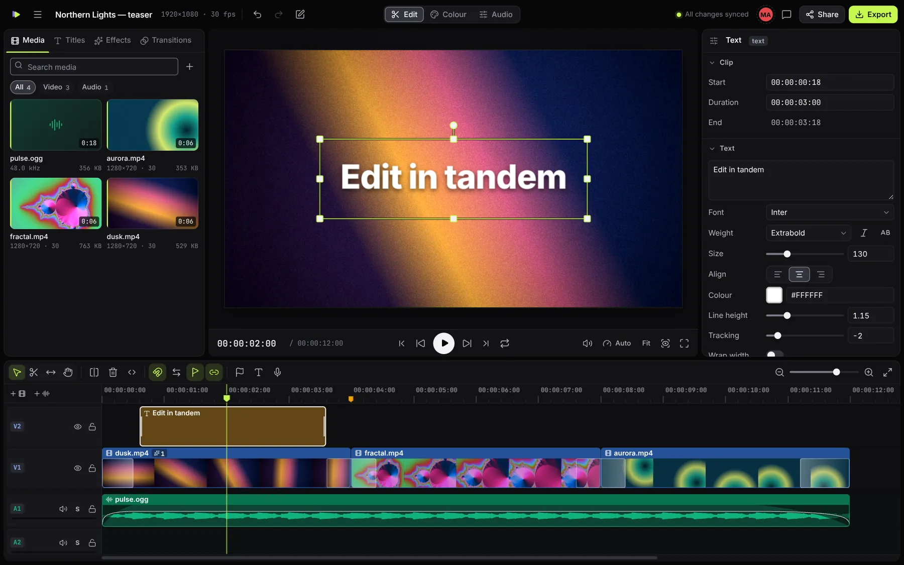
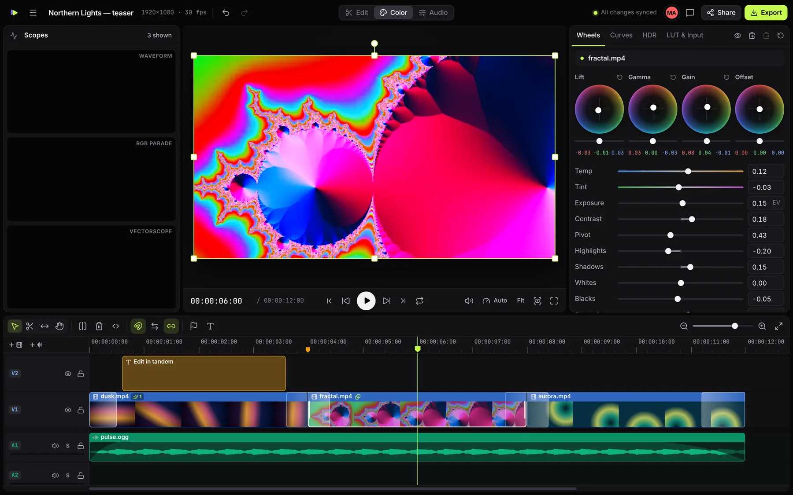
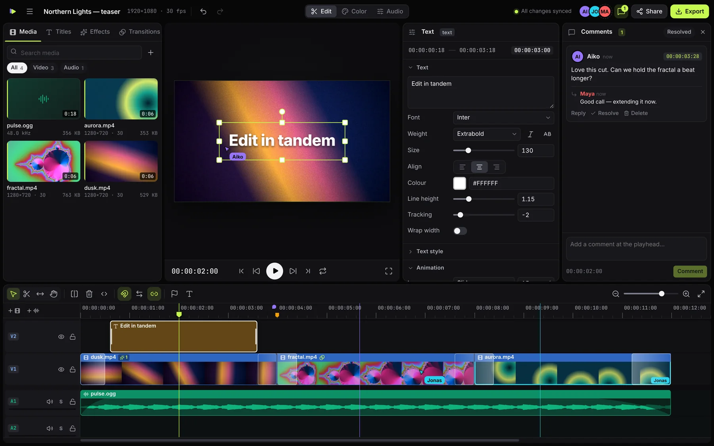

<p align="center">
  
</p>

<h1 align="center">Tandem</h1>

<p align="center">
  <b>The open-source multiplayer video editor.</b><br />
  A real non-linear editor that runs in a browser tab — and lets a whole team cut, grade and export in it at the same time.
</p>

<p align="center">
  <a href="#quick-start">Quick start</a> ·
  <a href="#what-it-does">Features</a> ·
  <a href="#self-hosting">Self-hosting</a> ·
  <a href="docs/ARCHITECTURE.md">Architecture</a> ·
  <a href="CONTRIBUTING.md">Contributing</a>
</p>



Tandem is free, MIT-licensed, has no accounts and no watermark. Decoding, compositing, grading and
encoding all happen on your own machine through WebCodecs and WebGL2. The optional server relays
edits between collaborators and keeps a project's media for them to stream. Footage goes to that
server and nowhere else, and with no server it never leaves your device.

## Quick start

```bash
git clone https://github.com/michaell14/co-video.git
cd co-video
pnpm install
pnpm dev
```

|                      |                       |
| -------------------- | --------------------- |
| Editor               | http://localhost:5173 |
| Website              | http://localhost:5174 |
| Collaboration server | http://localhost:8787 |

Requires Node 20+ and pnpm 10. Use a Chromium-based browser (Chrome, Edge, Arc, Brave) — see
[browser support](#browser-support).

No server? The editor also works entirely offline: `pnpm dev:editor` gives you a local-only editor
with projects stored in your browser.

## What it does

### Editing

- Unlimited video and audio tracks; clips are **resolution independent**, so a project can switch
  between 1080p, 4K, 8K or vertical without redoing anything. A change of frame rate re-times the
  whole edit, and clips, keyframes, markers and comments keep their place in real time
- Overwrite, insert, **ripple**, **roll**, **slip** and blade edits; magnetic snapping; linked
  audio / video; in / out ranges; J-K-L shuttle; frame-accurate stepping
- Markers with a note and a colour, and keys to step from one to the next
- A drag that reaches the edge of the timeline scrolls it, and the timeline's menus act where you
  click: “Add marker here”, “Close gap here”
- **Keyframes on every numeric property** — transform, opacity, crop, volume, pan and every effect
  parameter — with linear, hold, ease-in, ease-out or ease-in-out interpolation chosen per keyframe
- A clip's name, start and duration can be typed in the inspector: as timecode, as frames, as
  seconds (`2.5s`), or relative to where it is (`+12`, `-12`)
- Speed changes from 5 % to 10 000 %, reverse playback and freeze frames
- Titles with 13 bundled open-source typefaces, outlines, shadows, gradients, backgrounds and
  animated in / out presets; shapes, solids and **adjustment layers**
- Subtitles: import `.srt` / `.vtt` as editable captions, export `.srt` (captions only: titles and
  lower thirds are not subtitles)
- 18 blend modes, rectangular and elliptical masks with feathering, on-canvas transform handles
- A source monitor with in / out marking, driven by the same transport keys as the timeline. What
  is marked is inserted at the playhead or added there on a free track; **match frame** opens the
  monitor on the very frame under the playhead
- Replace or relink the file behind any asset; every clip follows, in one undo step. “Reveal in
  media pool” finds the file behind a clip, and a video can be added as picture only or sound only
- Projects save to a portable `.tandem` file. Opening one makes a new project, from the home screen
  or the editor; replacing the open project with one is a separate command that asks first
- The home screen renames, duplicates and deletes the projects on your device
- Per-user undo and redo, a command palette, and a complete keyboard workflow

### Effects

- **50 GPU effects** — blurs, glow, sharpen, clarity, chroma and luma keys, film grain, VHS, CRT,
  glitch, halftone, lens distortion, kaleidoscope, drop shadow, outline and more
- **25 transitions** — dissolves, wipes, pushes, cross zoom, whip pan, film burn, glitch…
- Effects and transitions are plain data (a parameter schema plus GLSL), so adding one is a single
  entry in a file

### Colour

- 16-bit float compositing end to end
- Lift / gamma / gain / offset wheels, 12 primary sliders, RGB curves, hue-vs-sat, hue-vs-hue and
  luma-vs-sat curves, six-zone tonal exposure, 3D `.cube` LUTs
- Waveform, RGB parade, vectorscope and histogram scopes that never stall playback
- Camera log inputs: Sony S-Log3, ARRI LogC3, Panasonic V-Log
- **HDR timelines** (Rec.2100 PQ and HLG) on a Rec.2020 working space, with 10- and 12-bit sources
  decoded at full precision and **HDR10 / HLG export**



### Audio

- Per-clip gain, pan and equal-power fades (all keyframeable); per-track fader, pan, mute, solo,
  three-band EQ and compressor; live peak meters; waveforms on the timeline
- **Loudness normalisation** to −14, −16 or −23 LUFS, measured to ITU-R BS.1770 with a peak
  ceiling (the meter agrees with `ffmpeg -af ebur128` to the tenth of a LU)
- **Voiceover recording** straight onto the timeline: the take lands on a free track where the
  playhead was, as an uncompressed, sample-accurate WAV
- The same mixer graph renders the preview and the export, so what you hear is what you deliver

### Multiplayer

- Real-time co-editing on a CRDT (Yjs): two people can move, trim and grade the same clip at once
  and every field converges
- Live cursors, playheads, selections and in-flight drags; follow someone's playhead with one click
- Time-coded comments with replies and resolve
- Share links with **editor**, **commenter** and **viewer** roles, enforced by the server
- Named versions plus automatic snapshots; restoring one is a single undoable step
- Offline-first: the editor is an installable web app that opens with no network, projects and
  media live on your device, and changes merge when you reconnect
- Media syncs itself — originals upload in resumable chunks and collaborators stream them
  immediately while a local copy downloads in the background. A transfer the network interrupted
  is tried again by itself, or at once from the media pool



### Heavy footage

- The viewer renders only as many pixels as it shows, and steps its resolution down while playing
  if the machine cannot keep up
- **Proxy media**: one click makes a small, quick-to-seek stand-in for 4K / 8K / high-frame-rate
  clips. The preview and the timeline thumbnails read the proxy; exports always read the original
- Sources that are drawn small are mipmapped, so downscaled 4K stays clean

### Export

- H.264, HEVC, VP9 and AV1 into MP4, MOV, WebM or MKV; WAV for audio; PNG stills
- Captions as `.srt`, and the cut itself as a CMX 3600 **EDL** for conforming in Resolve, Premiere
  or Avid
- Any resolution up to the encoder's limit (8K where the hardware allows) and any frame rate up to
  240 fps
- Deterministic, frame-by-frame rendering — a slow machine takes longer but produces the same file
- Media that is missing or will not decode is listed before the export starts. You can export
  anyway; the result then names every clip that left a gap
- Streams straight to disk, so file size is not limited by memory

## Keyboard

Press `?` in the editor for the full list; it is generated from the same table that drives the
shortcuts and the command palette (`Ctrl+K`). The ones worth learning first:

|                                                 |                                             |
| ----------------------------------------------- | ------------------------------------------- |
| Play / pause · shuttle back, stop, forwards     | `Space` · `J` `K` `L`                       |
| Step a frame · a second                         | `←` `→` · `Shift+←` `Shift+→`               |
| Previous / next edit · start / end              | `↑` `↓` · `Home` `End`                      |
| Mark in / out · mark the clip · clear the range | `I` `O` · `X` · `Alt+X`                     |
| Go to the in / out point                        | `Shift+I` `Shift+O`                         |
| Match frame                                     | `F`                                         |
| Source monitor: insert · add on a free track    | `F9` · `F10`                                |
| Select the clip under the playhead              | `Shift+V`                                   |
| Select the next / previous clip · add it        | `Ctrl+↓` `Ctrl+↑` · with `Shift`            |
| Select everything right / left of the playhead  | `Shift+End` · `Shift+Home`                  |
| Split · delete · ripple delete                  | `S` or `Ctrl+B` · `Delete` · `Shift+Delete` |
| Ripple trim the start / end to the playhead     | `Q` `W`                                     |
| Trim the nearest edge by a frame · by five      | `Ctrl+←` `Ctrl+→` · with `Shift`            |
| Extend the edit to the playhead                 | `E`                                         |
| Add the default transition to the selected cuts | `Shift+D`                                   |
| Close the gap at the playhead                   | `Shift+G`                                   |
| Nudge the selection by a frame · by ten         | `,` `.` · `Shift+,` `Shift+.`               |
| Move the selection up / down a track            | `Alt+↑` `Alt+↓`                             |
| Marker: add or remove · next · previous         | `M` · `Shift+M` · `Ctrl+Shift+M` or `Alt+M` |
| Tools: select · blade · slip · hand             | `V` · `B` · `Y` · `H`                       |
| Zoom the timeline · fit it · zoom to selection  | `+` `-` · `Shift+Z` · `Z`                   |
| Add a title                                     | `T`                                         |
| Edit · Colour · Audio workspace                 | `Shift+1` · `Shift+2` · `Shift+3`           |
| Comments                                        | `Shift+C`                                   |
| Import · export · export the frame as a PNG     | `Ctrl+I` · `Ctrl+E` · `Ctrl+Shift+E`        |
| Save a project file · open one as a new project | `Ctrl+S` · `Ctrl+O`                         |

`Ctrl` is `⌘` on a Mac. A few of these are narrower than their names: `Q` and `W` trim one shot,
the selected clip or else the picture under the playhead, and leave a music bed or a title under
the same frame alone; `Shift+G` closes one gap, the picture's, and the other tracks follow it.
`Space` plays and pauses, except on a button the keyboard itself moved to (with `Tab`), where it
presses the button.

While the source monitor is open, `Space`, `J` `K` `L`, the arrow keys (with `Shift` for a second),
`Home`, `End`, `I` and `O` drive it instead of the timeline; `Shift+I` and `Shift+O` go to its
marks and `Alt+X` clears them. `,` and `.` do not nudge then: like `F9` and `F10` they put what is
marked (the whole file when nothing is) on the timeline at the playhead. `,` inserts it: every
unlocked track is cut at the playhead and what follows moves later to make room. `.` adds it on a
free track and changes nothing else. The monitor stays open after either, and `Esc` closes it.

## Browser support

Tandem is built on WebCodecs, WebGL2 float render targets and the Origin Private File System.

| Browser                             | Status                                                            |
| ----------------------------------- | ----------------------------------------------------------------- |
| Chrome / Edge / other Chromium 120+ | Supported. This is what the test suite runs on.                   |
| Safari 17+, Firefox 130+            | The required APIs exist but are **untested**; expect rough edges. |

Which codecs you can import and export depends on the browser and your GPU. Tandem asks the
browser what it can really encode at the chosen size and only offers those options. HEVC and
hardware-accelerated paths in particular vary by platform.

## Self-hosting

One small Node process serves the website, the editor and the collaboration API.

```bash
pnpm build
pnpm start            # http://localhost:8787  (editor at /app/)
```

or with Docker:

```bash
docker build -t tandem .
```

```bash
docker run -p 8787:8787 -v tandem-data:/data tandem
```

**Anywhere but `localhost`, the editor needs HTTPS to work at all.** Browsers offer WebCodecs, the
private file system, service workers, the clipboard and the microphone only to pages that came
over HTTPS (or from `localhost`). Opened at `http://your-server:8787/app/` the editor loads, shows
a black viewer, decodes nothing, stores nothing on the device and does not open offline. The server
itself speaks plain HTTP and compresses nothing, so put a reverse proxy that terminates TLS in
front of it. With [Caddy](https://caddyserver.com), which gets the certificate by itself and passes
WebSocket upgrades on, this is the whole configuration (the `encode` line is what compresses the
editor's code on its way out):

```
tandem.example.com {
	encode zstd gzip
	reverse_proxy localhost:8787
}
```

Start the server with `TRUST_PROXY=true` behind it, so that clients are told apart by their own
address and not the proxy's.

Configuration is by environment variable: `PORT`, `HOST`, `DATA_DIR`, `CORS_ORIGIN`,
`TANDEM_OPEN_CREATE`, `MAX_CREATES_PER_HOUR`, `TRUST_PROXY`, `AUTO_SNAPSHOT_MS`, and the limits
below. [`apps/server/README.md`](apps/server/README.md) has what each one means, the on-disk
layout and the security model. In short: projects are protected by unguessable capability links
and there are no user accounts.

| Limit                      | Default            | Bounds                                                |
| -------------------------- | ------------------ | ----------------------------------------------------- |
| `MAX_UPLOAD_BYTES`         | 20 GiB             | one media file                                        |
| `UPLOAD_EXPIRY_DAYS`       | 7                  | how long an unfinished upload is kept (`0`: for ever) |
| `MAX_CONNECTIONS_PER_IP`   | 200                | open sockets from one address                         |
| `MAX_CONNECTIONS_PER_ROOM` | 100                | open sockets on one document of a project             |
| `MAX_PROJECT_DOC_BYTES`    | 32 MiB             | a project document                                    |
| `MAX_REVIEW_DOC_BYTES`     | 2 MiB              | a project's comments                                  |
| `MAX_OPEN_DOC_BYTES`       | 1 % of the V8 heap | all documents in memory together                      |
| `MAX_PRESENCE_BYTES`       | 256 KiB            | one presence update, and what one link shows in all   |
| `MAX_SYNC_BACKLOG_BYTES`   | 128 MiB            | document copies on their way to clients               |

The editor can also be hosted somewhere else than the server, on a static host or a CDN. Build it
with `VITE_SERVER_URL` set to the server's address and `TANDEM_BASE` to the path it will be served
under, and tell the server who may call it:

```bash
VITE_SERVER_URL=https://api.example.com TANDEM_BASE=/ pnpm --filter @tandem/editor build
```

```bash
CORS_ORIGIN=https://edit.example.com pnpm start
```

[`apps/server/README.md`](apps/server/README.md#the-editor-on-another-origin) has the details,
among them what such a host has to do that the bundled server does by itself.

## Testing

```bash
pnpm typecheck
pnpm test         # unit tests: model, edit operations, colour math, server, editor logic
pnpm test:e2e     # Playwright: editor + server + render engine in Chromium
pnpm test:smoke   # the production build, served by the built server, in a browser
```

The end-to-end suite drives the real application: it edits with the mouse, exports through the
export dialog and inspects the files with `ffprobe`, connects several browsers to one project,
records a voiceover from a fake microphone, builds a proxy, and compares the picture that an HDR
export hands to the encoder with its 10-bit PQ source, to within one code value. The smoke test
goes through the built product once, under the security headers and the service worker that only
a production build has. CI runs all of it on every pull request, and also builds the Docker image
and checks what the container serves. [`CONTRIBUTING.md`](CONTRIBUTING.md) says how to run the
browser tests beside a dev server and what a failed one leaves behind.

## How it is built

```
packages/core      project model · Yjs store · edit operations · frame resolver · colour math
packages/engine    WebGL2 compositor · WebCodecs decode · Web Audio mixer · player · exporter
apps/editor        the React editor
apps/server        collaboration + media server (node:http, ws, Yjs)
apps/site          the website
```

Three ideas carry most of the weight:

1. **Every edit is an operation.** Moving a clip, dragging a slider or importing captions all
   produce a list of atomic `Edit`s. Committing that list is one undo step and one network update;
   applying it to a snapshot instead gives a live drag preview. Features get undo, multiplayer and
   previews without writing any of the three.
2. **The model is flat and mergeable.** Clips live in a map keyed by id with their track as a
   field, so concurrent edits by different people merge per field rather than fighting over a
   nested list.
3. **One renderer.** Preview and export run the same compositor on the same resolved frame
   description; the only difference is whether it waits for exact frames.

[`docs/ARCHITECTURE.md`](docs/ARCHITECTURE.md) goes through all of it.

## Honest limitations

- Tested on Chromium only (see above).
- No account system: access control is by capability link. Fine for teams; not a public SaaS
  permission model.
- HDR _display_ preview is tone-mapped to SDR in the viewer; scopes read true PQ nits and exports
  are true HDR. Wide-gamut canvas output is not wired up yet.
- Speed changes resample audio (pitch follows speed); there is no pitch-preserving time stretch,
  and no keyframed speed ramps.
- Keyframes ease by preset; there is no curve editor with bezier handles.
- No multicam, no nested sequences, no motion tracking, no AI features. Not yet.
- A change of frame rate re-times what the project holds at that moment. Edits a collaborator made
  offline at the old rate arrive with their old frame numbers when they reconnect.
- Proxies are made and kept per device; collaborators each create their own. HDR sources are not
  proxied.
- EDL export is cuts-only (transitions are listed as comments) and assumes source timecode starts
  at zero.
- Two people who put a clip on the same frames of a track at the same moment both succeed. One of
  the two clips is then moved to a free track, a moment after the edits meet, by the session that
  placed it. If that session has gone by then, the clips stay on top of each other, marked in the
  timeline, until someone moves one (“Move to a free track” in the clip's menu).
- Two changes of frame rate made at the same moment: one of them decides where every clip is, but
  fades, keyframes, transition lengths and review comments can end up timed for the other.
- Whose comment is whose is kept by the editor, not by the server, which knows roles and not
  people: anyone with a comment link and a client of their own can rewrite or delete other people's
  comments.
- Nothing deletes a project or its media from the server. Deleting a project on the home screen
  removes it from that device; on the server it stays until someone removes its folder.
- Vorbis sound that starts part-way into its file is placed about 20 ms early, in the preview and
  in exports alike (a limit of the decoder library; the offset is constant over the clip).
- Performance on very long 4K+ timelines has been engineered for (virtualised timeline,
  look-ahead decode, preview-resolution scaling) but has only been measured on modest hardware.

## Licence

[MIT](LICENSE). Built on the excellent [Mediabunny](https://mediabunny.dev) (MPL-2.0) for
demuxing and muxing, and [Yjs](https://yjs.dev) (MIT) for CRDTs. Bundled typefaces are under the
SIL Open Font Licence, except Permanent Marker (Apache 2.0).
[`THIRD_PARTY_NOTICES.txt`](apps/editor/public/THIRD_PARTY_NOTICES.txt) names everything a build
contains, with the licences in full. It is part of every build of the editor, so a server has it at
`/app/THIRD_PARTY_NOTICES.txt`.
