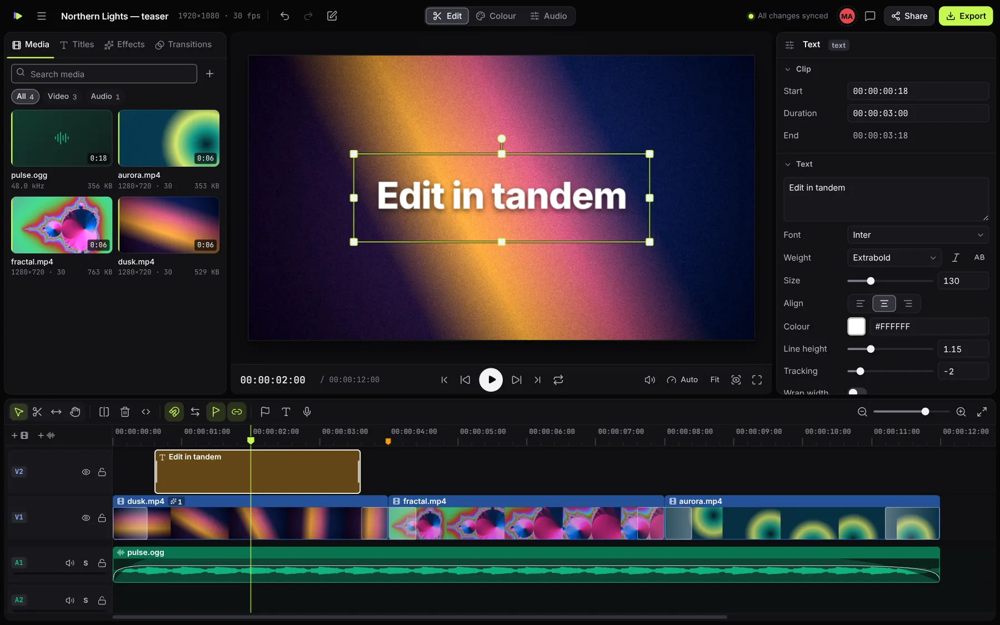
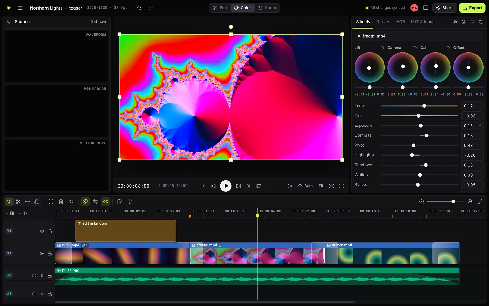
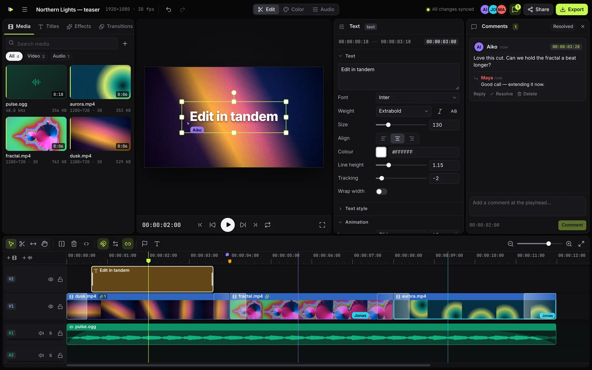

<p align="center">
  
</p>

<h1 align="center">Tandem</h1>

<p align="center">
  <b>The open-source multiplayer video editor.</b><br />
  A real non-linear editor that runs in a browser tab — and lets a whole team cut, grade and export in it at the same time.
</p>

<p align="center">
  <a href="#quick-start">Quick start</a> ·
  <a href="#what-it-does">Features</a> ·
  <a href="#self-hosting">Self-hosting</a> ·
  <a href="docs/ARCHITECTURE.md">Architecture</a> ·
  <a href="CONTRIBUTING.md">Contributing</a>
</p>



Tandem is free, MIT-licensed, has no accounts and no watermark. Decoding, compositing, grading and
encoding all happen on your own machine through WebCodecs and WebGL2. The optional server relays
edits between collaborators and keeps a project's media for them to stream. Footage goes to that
server and nowhere else, and with no server it never leaves your device.

## Quick start

```bash
git clone https://github.com/michaell14/co-video.git
cd co-video
pnpm install
pnpm dev
```

|                      |                       |
| -------------------- | --------------------- |
| Editor               | http://localhost:5173 |
| Website              | http://localhost:5174 |
| Collaboration server | http://localhost:8787 |

Requires Node 20+ and pnpm 10. Use a Chromium-based browser (Chrome, Edge, Arc, Brave) — see
[browser support](#browser-support).

The website's “Open the editor” leads to port 5173, so the editor's dev server takes that port or
none: when it is in use, starting fails and says so. To run the editor on another port, tell the
website where it is:

```bash
pnpm dev:editor --port 5199
VITE_EDITOR_URL=http://localhost:5199/ pnpm dev:site
```

No server? The editor also works entirely offline: `pnpm dev:editor` gives you a local-only editor
with projects stored in your browser.

## What it does

### Editing

- Unlimited video and audio tracks; clips are **resolution independent**, so a project can switch
  between 1080p, 4K, 8K or vertical without redoing anything. A change of frame rate re-times the
  whole edit, and clips, keyframes, markers and comments keep their place in real time
- Overwrite, insert, **ripple**, **roll**, **slip** and blade edits; magnetic snapping; linked
  audio / video; in / out ranges; J-K-L shuttle; frame-accurate stepping
- A clip or a file that is dropped overwrites what it lands on; dropped with `Ctrl` held it goes in
  between, and what follows moves later to make room. `Ctrl+Shift+V` pastes the same way. A roll
  (`Ctrl`-drag on a cut) moves the cut of linked picture and sound together, and with linked
  selection switched off the cut of one of them, for a split edit
- Markers with a note and a colour, and keys to step from one to the next. Markers and review
  comments move with ripple edits, so each stays on the shot it was put on, and return when the edit
  is undone; one switch, “Comments and markers follow ripple edits” in the timeline's toolbar, the
  edit commands menu and the palette, keeps both where they are instead
- A drag that reaches the edge of the timeline scrolls it, and the timeline's menus act where you
  click: “Add marker here”, “Close gap here”
- **Keyframes on every numeric property** — transform, opacity, crop, volume, pan and every effect
  parameter — with linear, hold, ease-in, ease-out or ease-in-out interpolation chosen per keyframe.
  The keyframes of a selected clip are marked on it in the timeline, where they can be dragged, and
  `[` and `]` step from one to the next
- A clip's name, start and duration can be typed in the inspector: as timecode, as frames, as
  seconds (`2.5s`), or relative to where it is (`+12`, `-12`)
- Speed changes from 5 % to 10 000 %, reverse playback and freeze frames
- **Speed ramps**: a clip's speed can change along its media. The inspector's Speed section has a
  chip for None, Custom (a level ramp to shape by hand) and seven ready-made shapes (Ramp up, Ramp
  down, Montage, Hero, Bullet, Flash in, Flash out), and for a clip on a ramp a graph of the speed,
  from 10 % to 1000 %, over the media the clip plays, with the playhead on it and marks under it for
  the seconds of the clip. A point is dragged up and down for its speed and sideways for its place,
  and snaps to 100 % and to the playhead unless `Shift` is held; a double-click adds a point on the
  curve or removes the one it is on; a press beside the points moves the playhead. Between two
  points the speed eases from the one to the other. On a ramp the Speed row shows the average and
  cannot be set; a preset or None takes the clip back to one speed
- A ramp changes how long a clip is, as a change of speed does: the same stretch of media plays,
  faster here and slower there. With ripple editing on, what follows moves with the clip's end;
  without it the clip stops at the next one, says so and offers to make room. For one clip the
  notice gives the length it plays and the length it would need, in seconds, or in frames where the
  two would read alike (“the first 120 of its 121 frames”). A drag of a point is one undo step. A
  ramp is one for a picture and the sound linked to it, whatever the linked selection, and the two
  stay in step, also as a split edit; it is refused while one of them is on a locked track
- A clip on a ramp says so on the timeline. Its chip reads “Ramp” (“−Ramp” when it plays backwards)
  and names its slowest and fastest speed when pointed at, its filmstrip shows on each tile the
  picture of that moment, and its waveform is drawn where the sound plays, wide where the clip is
  slow and close where it is fast. The clip's menu has “Speed ramp…” (None, the seven shapes with
  the present one ticked, “Add point at playhead”), and the command palette has the same by name:
  “Speed ramp: Bullet”, “Add ramp point at playhead”. “Reverse” in the clip's menu and in the
  inspector turns a clip round and leaves its speed, its ramp and its length as they are
- **Keep pitch**: sound at another speed, or on a ramp, plays at its own pitch instead of rising
  and falling with the speed. It is a switch in the Speed section for whatever reaches a sound
  clip, an entry in a sound clip's menu and “Keep pitch: on or off” in the palette, and it works
  between 10 % and 1000 %. The first change of a sound clip's speed or ramp made from now on
  switches it on; sound in projects made before, and sound nobody retimes, plays as it did
- Titles with 13 bundled open-source typefaces, outlines, shadows, gradients, backgrounds and
  animated in / out presets; shapes, solids and **adjustment layers**
- A title is typed into where it stands in the picture: double-click it in the viewer and the caret
  is in its text at that place, in its own type, turned and scaled as it is drawn. A new title
  starts out that way, with its placeholder selected. `Esc`, `Ctrl+Enter` or a press anywhere else
  ends the typing, and all of it is one undo step. A title in a box wraps as text does in the
  browser: at spaces, after a hyphen or a dash, never at a no-break space, and a word that ends at
  the edge stays on the line wherever the browser keeps it
- Subtitles: import `.srt` / `.vtt` as editable captions, export `.srt` (captions only: titles and
  lower thirds are not subtitles)
- 18 blend modes, rectangular and elliptical masks with feathering, on-canvas transform handles
- A source monitor with in / out marking, driven by the same transport keys as the timeline. What
  is marked is inserted at the playhead, added there on a free track, or dragged to the timeline by
  the file's name; **match frame** opens the monitor on the very frame under the playhead. It stays
  open from one select to the next, and while the project is open it remembers the marks and the
  position of every file it has shown
- The media pool has a selection like a file manager's (click, `Shift`, `Ctrl`, `Ctrl+A`, `Space`
  from the keyboard). A drag or the `+` takes the selected files to the timeline end to end, and
  `Delete` removes them, after asking when there are several or one is in use. “Remove unused
  media…” clears the pool of every file no clip uses, in one undoable step
- Replace or relink the file behind any asset; every clip follows, in one undo step. A file dropped
  on a clip with `Alt` held takes the place of that one clip's media and keeps everything that was
  done to the clip, as does “Replace selected clip with this” in the file's menu. “Reveal in media
  pool” finds the file behind a clip, and a video can be added as picture only or sound only
- A clip says what is wrong with it where it lies: **Offline** when its file is on neither this
  device nor the server, **Unsupported** when this browser cannot decode it (**No decoder** where
  the browser has no decoder at all, **Needs HTTPS** on an address that is neither HTTPS nor
  `localhost`), **Overlap** when it shares frames with another clip of its track (its menu has “Move
  to a free track”). The viewer says in a line why the picture under the playhead is black, the
  inspector says it of the selected clip, and the media pool marks a file this browser cannot
  decode. A clip whose sound has a decoder that gives nothing is marked **Unsupported** as well, and
  the inspector says under its sentence what the decoder said. A clip that the preview has played
  without a part of its sound, because a stretch of its file would not decode or its decoder stopped
  part-way, plays on and is marked **Sound gap** or **Sound stops**, a warning like **Overlap**: its
  read-out says from when, and the inspector says it in a sentence with the timecode, which moves
  the playhead there, and the cause. The mark lasts until the clip no longer plays that place or its
  file is read anew or replaced
- Sound is not lost at the first error: a damaged stretch of a file costs that stretch (about 70 ms
  for one bad AAC packet) and the rest of the clip plays. AAC that the browser's WebCodecs decoder
  will not decode (AAC-LC at any rate, HE-AAC and HE-AAC v2) is decoded by the browser's other
  decoder instead, the one that plays a file in a `<video>`. In Chromium it is the same sound,
  sample for sample, in the same place
- Projects save to a portable `.tandem` file. Opening one makes a new project, from the home screen
  or the editor; replacing the open project with one is a separate command that asks first
- The home screen renames, duplicates and deletes the projects on your device. The owner of a
  shared project can also delete it for everyone there: the server then holds nothing of it and
  every link to it stops working
- Per-user undo and redo, a command palette, and a complete keyboard workflow

### Effects

- **50 GPU effects** — blurs, glow, sharpen, clarity, chroma and luma keys, film grain, VHS, CRT,
  glitch, halftone, lens distortion, kaleidoscope, drop shadow, outline and more
- **25 transitions** — dissolves, wipes, pushes, cross zoom, whip pan, film burn, glitch…
- Effects and transitions are plain data (a parameter schema plus GLSL), so adding one to the
  editor is a single entry in a file. The website and this list name and count them too, and a
  test says what else to edit ([`CONTRIBUTING.md`](CONTRIBUTING.md#adding-an-effect-or-a-transition))

### Colour

- 16-bit float compositing end to end
- Lift / gamma / gain / offset wheels, 12 primary sliders, RGB curves, hue-vs-sat, hue-vs-hue and
  luma-vs-sat curves, six-zone tonal exposure, 3D `.cube` LUTs
- Waveform, RGB parade, vectorscope and histogram scopes that never stall playback
- Camera log inputs: Sony S-Log3, ARRI LogC3, Panasonic V-Log
- **HDR timelines** (Rec.2100 PQ and HLG) on a Rec.2020 working space, with 10- and 12-bit sources
  decoded at full precision and **HDR10 / HLG export**



### Audio

- Per-clip gain, pan and equal-power fades (all keyframeable); per-track fader, pan, mute, solo,
  three-band EQ and compressor; live peak meters; waveforms on the timeline, drawn through a clip's
  speed and its ramp
- A sound clip's level is drawn over its waveform as a line. On a selected clip the line is dragged
  up or down to set the level, a `Ctrl`-click on it makes a volume keyframe, and a keyframe on it is
  dragged like the line
- **Loudness normalisation** to −14, −16 or −23 LUFS, measured to ITU-R BS.1770 with a peak ceiling
  (the meter agrees with `ffmpeg -af ebur128` to the tenth of a LU); it measures the sound as it
  plays, through whichever decoder the file is on, and a stretch that would not decode does not
  count
- **Voiceover recording** straight onto the timeline: the take lands on a free track where the
  playhead was, as an uncompressed, sample-accurate WAV
- The same mixer graph renders the preview and the export, so what you hear is what you deliver

### Multiplayer

- Real-time co-editing on a CRDT (Yjs): two people can move, trim and grade the same clip at once
  and every field converges
- Live cursors, playheads, selections and in-flight drags; follow someone's playhead with one click
- Time-coded comments with replies and resolve. A comment stays on its shot when the cut is
  rippled: whoever makes the edit moves it, for everyone, and undoing the edit brings it back
- Share links with **editor**, **commenter** and **viewer** roles, enforced by the server. For
  someone who may not edit, the inspector, the colour page and the mixer say “Read only”, and their
  controls and the timeline's editing buttons are out of reach. What they select is outlined in the
  viewer without the handles to move it by, and the track heights they set are their own, kept per
  project on the device
- Named versions plus automatic snapshots; restoring one is a single undoable step, and the owner
  and editors can delete a version in the version history
- Offline-first: the editor is an installable web app that opens with no network, projects and
  media live on your device, and changes merge when you reconnect
- Media syncs itself — originals upload in resumable chunks and collaborators stream them
  immediately while a local copy downloads in the background. A transfer the network interrupted is
  tried again by itself, or at once from the media pool
- The top bar says how the project stands with the server, also when it does not: “Not syncing:
  link refused” for a project whose link the server no longer accepts (Share has “Try again”),
  “Waiting for the server” while a server that answers has no place for the project yet, and “Not
  saving to the server” when the server has stopped taking changes, with the reason, such as a
  project that has reached the size the server allows. The changes stay on the device meanwhile and
  are offered to the server again every minute
- Clips that two people put on the same frames are moved apart, and clips whose track someone else
  removed are kept: a notice in the timeline restores them to a new track or discards them
- The home screen marks a project whose link was refused and says when the browser has no room left
  to save the list of projects. The screen that stands in for a project that is not available offers
  “Try again”, except for one its owner deleted: that screen says so, says that nothing of it is
  left on the server, and offers only the way back to the projects. A shared project that has not
  arrived on a device yet is shown as opening, never as an empty timeline, and a wait that goes on
  offers the way back to the projects



### Heavy footage

- The viewer renders only as many pixels as it shows, and steps its resolution down while playing
  if the machine cannot keep up
- **Proxy media**: one click makes a small, quick-to-seek stand-in for 4K / 8K / high-frame-rate
  clips. The preview and the timeline thumbnails read the proxy; exports always read the original
- Sources that are drawn small are mipmapped, so downscaled 4K stays clean

### Export

- H.264, HEVC, VP9 and AV1 into MP4, MOV, WebM or MKV; WAV for audio; PNG stills
- Captions as `.srt`, and the cut itself as a CMX 3600 **EDL** for conforming in Resolve, Premiere
  or Avid
- Any resolution up to the encoder's limit (8K where the hardware allows) and any frame rate up to
  240 fps. The dialog asks the encoder about the chosen codec, size and bitrate before anything is
  rendered, in 10 bits for an HDR export, and says what it would take instead of failing after the
  file has been named
- Deterministic, frame-by-frame rendering — a slow machine takes longer but produces the same file
- Media that is missing or will not decode is listed before the export starts. You can export
  anyway; the result then names every clip that left a gap. For sound or picture that would not
  decode it says how much is missing (a stretch, the rest, all of it), from which timecode, and
  under the sentence what the decoder said, as text that can be copied
- Streams straight to disk, so file size is not limited by memory. “Cancel export” works until the
  file is finished: only the last step, saving it where you chose, cannot be stopped. Leaving the
  project cancels a running export

## Keyboard

Press `?` in the editor for the full list; it is generated from the same table that drives the
shortcuts and the command palette (`Ctrl+K`). The ones worth learning first:

|                                                 |                                             |
| ----------------------------------------------- | ------------------------------------------- |
| Play / pause · shuttle back, stop, forwards     | `Space` · `J` `K` `L`                       |
| Step a frame · a second                         | `←` `→` · `Shift+←` `Shift+→`               |
| Previous / next edit · start / end              | `↑` `↓` · `Home` `End`                      |
| Mark in / out · mark the clip · clear the range | `I` `O` · `X` · `Alt+X`                     |
| Go to the in / out point                        | `Shift+I` `Shift+O`                         |
| Previous / next keyframe of the selected clips  | `[` `]`                                     |
| Match frame                                     | `F`                                         |
| Source monitor: insert · add on a free track    | `F9` · `F10`                                |
| Select the clip under the playhead              | `Shift+V`                                   |
| Select the next / previous clip · add it        | `Ctrl+↓` `Ctrl+↑` · with `Shift`            |
| Select everything right / left of the playhead  | `Shift+End` · `Shift+Home`                  |
| Split · delete · ripple delete                  | `S` or `Ctrl+B` · `Delete` · `Shift+Delete` |
| Ripple trim the start / end to the playhead     | `Q` `W`                                     |
| Trim the nearest edge by a frame · by five      | `Ctrl+←` `Ctrl+→` · with `Shift`            |
| Extend the edit to the playhead                 | `E`                                         |
| Add the default transition to the selected cuts | `Shift+D`                                   |
| Close the gap at the playhead                   | `Shift+G`                                   |
| Paste · paste insert (what follows makes room)  | `Ctrl+V` · `Ctrl+Shift+V`                   |
| Nudge the selection by a frame · by ten         | `,` `.` · `Shift+,` `Shift+.`               |
| Move the selection up / down a track            | `Alt+↑` `Alt+↓`                             |
| Marker: add or remove · next · previous         | `M` · `Shift+M` · `Ctrl+Shift+M` or `Alt+M` |
| Tools: select · blade · slip · hand             | `V` · `B` · `Y` · `H`                       |
| Zoom the timeline · fit it · zoom to selection  | `+` `-` · `Shift+Z` · `Z`                   |
| Add a title                                     | `T`                                         |
| Type into the selected title · end the typing   | `Enter` or `F2` · `Esc` or `Ctrl+Enter`     |
| Edit · Colour · Audio workspace                 | `Shift+1` · `Shift+2` · `Shift+3`           |
| Comments                                        | `Shift+C`                                   |
| Import · export · export the frame as a PNG     | `Ctrl+I` · `Ctrl+E` · `Ctrl+Shift+E`        |
| Save a project file · open one as a new project | `Ctrl+S` · `Ctrl+O`                         |

`Ctrl` is `⌘` on a Mac. A few of these are narrower than their names: `Q` and `W` trim one shot,
the selected clip or else the picture under the playhead, and leave a music bed or a title under
the same frame alone; `Shift+G` closes one gap, the picture's, and the other tracks follow it.
`Space` plays and pauses, except on a button the keyboard itself moved to (with `Tab`), where it
presses the button.

While a title is typed into, every key is text: `Space` does not play, `Delete` does not remove the
clip, and `Ctrl+Z` takes back typing, not the edit before it. `Enter` starts the typing only where
no control has the keyboard (on a button it presses the button, and on a clip the keyboard has
walked to it selects); `F2` starts it anywhere. A title that is not on show at the playhead is typed
in the inspector's field instead, and a title left empty says again what it said before. The command
palette has the same as “Type into the selected title”, and says why when there is no one title
selected that you may type into.

While the source monitor is open, `Space`, `J` `K` `L`, the arrow keys (with `Shift` for a second),
`Home`, `End`, `I` and `O` drive it instead of the timeline; `Shift+I` and `Shift+O` go to its
marks and `Alt+X` clears them. `,` and `.` do not nudge then: like `F9` and `F10` they put what is
marked (the whole file when nothing is) on the timeline at the playhead. `,` inserts it: every
unlocked track is cut at the playhead and what follows moves later to make room. `.` adds it on a
free track and leaves every other clip where it is. The monitor stays open after either, and `Esc`
closes it.

The points of a speed ramp, in the graph of the inspector's Speed section, are stops for `Tab`. On
a point, and with the pointer in the graph:

|                                                   |                                    |
| ------------------------------------------------- | ---------------------------------- |
| Speed up / down by a twentieth · by 1.62 times    | `↑` `↓` · with `Shift`             |
| Double / halve the speed                          | `Page Up` `Page Down`              |
| Slowest (10 %) / fastest (1000 %)                 | `Home` `End`                       |
| Move the point a hundredth of the graph · a tenth | `←` `→` · with `Shift`             |
| Remove the point                                  | `Delete` or `Backspace`            |
| Take the playhead to the point                    | `Enter`                            |
| Move a point                                      | drag it                            |
| Add a point on the curve · remove a point         | double-click the graph · the point |
| Take the playhead to a moment of the clip         | press beside the points, and drag  |

The graph runs from left to right in the order the clip plays, so `→` takes a point to the right and
later in the clip, also on a clip that plays backwards, where that is earlier in its file. A point
stops a hundredth of the graph short of its neighbours and at the ends of what the clip plays, and a
drag snaps to 100 % and to the playhead unless `Shift` is held. A run of key presses is one undo
step and so is a drag; a point added or removed is a step of its own, and removing one by key hands
the keyboard to the point beside it. “Add point” under the graph puts a point where the playhead is,
or in the widest gap when the playhead is off the clip or on a point, and for someone working by
keyboard the keyboard goes to the new point. A ramp keeps at least two points and holds 32 at most.

The rest of the editor is within reach of the keyboard as well:

- The timeline's clips are one stop for `Tab`. On a clip the keyboard has reached, `←` `→` go to
  the clip before and after it, `↑` `↓` to the track above and below, `Home` and `End` to the first
  and last clip of the track. The selection goes along, and grows with `Shift`; `Enter` and `Space`
  select the clip the keyboard is on, and `Shift+F10` opens its menu. A press of the pointer gives
  the arrow keys back to the playhead
- A slider moves a step with the arrow keys and ten with `Shift`, a tenth of its range with
  `Page Up` and `Page Down`, to either end with `Home` and `End`, and back to its default with
  `Delete` or `Backspace`. A run of presses is one undo step. The colour wheels, the points of a
  curve, the tonal zones and the mixer's faders take the same keys. The splitters between the
  panels are stops for `Tab` as well, and move with the arrows, the page keys, `Home` and `End`
- The arrow keys step through the tabs of the library and of the colour page
- A tooltip shows for the control the keyboard is on as it does under the pointer, and a notice
  that offers something to do (“Undo”, “Try again”) stays for nine seconds and waits while the
  pointer or the keyboard is on it
- A button that is at work on what it was pressed for (a link being made, a version saved or
  restored, a project published, the media looked at before an export) keeps the keyboard and
  takes no second press, and a key held down on it presses it once. Where the answer puts
  something else in its place, the keyboard goes on from what stands there

## Browser support

Tandem is built on WebCodecs, WebGL2 float render targets and the Origin Private File System.

| Browser                             | Status                                                            |
| ----------------------------------- | ----------------------------------------------------------------- |
| Chrome / Edge / other Chromium 120+ | Supported. This is what the test suite runs on.                   |
| Safari 17+, Firefox 130+            | The required APIs exist but are **untested**; expect rough edges. |

Which codecs you can import and export depends on the browser and your GPU. Tandem asks the
browser what it can really encode at the chosen size and only offers those options. HEVC and
hardware-accelerated paths in particular vary by platform.

## Self-hosting

One small Node process serves the website, the editor and the collaboration API.

```bash
pnpm build
pnpm start            # http://localhost:8787  (editor at /app/)
```

or with Docker:

```bash
docker build -t tandem .
```

```bash
docker run -p 8787:8787 -v tandem-data:/data tandem
```

**Anywhere but `localhost`, the editor needs HTTPS to work at all.** Browsers offer WebCodecs, the
private file system, service workers, the clipboard and the microphone only to pages that came
over HTTPS (or from `localhost`). Opened at `http://your-server:8787/app/` the editor loads, shows
a black viewer, decodes nothing, stores nothing on the device and does not open offline, and says
why in a notice above every screen. (Projects are still shared and synced there; a share link has to
be copied by hand from its field.) The server
itself speaks plain HTTP and compresses nothing, so put a reverse proxy that terminates TLS in
front of it. With [Caddy](https://caddyserver.com), which gets the certificate by itself and passes
WebSocket upgrades on, this is the whole configuration (the `encode` line is what compresses the
editor's code on its way out):

```
tandem.example.com {
	encode zstd gzip
	reverse_proxy localhost:8787
}
```

Start the server with `TRUST_PROXY=true` behind it, so that clients are told apart by their own
address and not the proxy's.

Configuration is by environment variable: `PORT`, `HOST`, `DATA_DIR`, `CORS_ORIGIN`,
`TANDEM_OPEN_CREATE`, `MAX_CREATES_PER_HOUR`, `TRUST_PROXY`, `AUTO_SNAPSHOT_MS`, and the limits
below. [`apps/server/README.md`](apps/server/README.md) has what each one means, the on-disk
layout and the security model. In short: projects are protected by unguessable capability links
and there are no user accounts.

| Limit                       | Default            | Bounds                                                                                     |
| --------------------------- | ------------------ | ------------------------------------------------------------------------------------------ |
| `MAX_UPLOAD_BYTES`          | 20 GiB             | one media file                                                                             |
| `UPLOAD_EXPIRY_DAYS`        | 7                  | how long an unfinished upload is kept (`0`: for ever)                                      |
| `UNUSED_MEDIA_EXPIRY_HOURS` | 24                 | how long media is kept once neither the project nor a version refers to it (`0`: for ever) |
| `MAX_CONNECTIONS_PER_IP`    | 200                | open sockets from one address                                                              |
| `MAX_CONNECTIONS_PER_ROOM`  | 100                | open sockets on one document of a project                                                  |
| `MAX_PROJECT_DOC_BYTES`     | 32 MiB             | a project document                                                                         |
| `MAX_REVIEW_DOC_BYTES`      | 2 MiB              | a project's comments                                                                       |
| `MAX_OPEN_DOC_BYTES`        | 1 % of the V8 heap | all documents in memory together                                                           |
| `MAX_PRESENCE_BYTES`        | 256 KiB            | one presence update, and what one link shows in all                                        |
| `MAX_SYNC_BACKLOG_BYTES`    | 128 MiB            | document copies on their way to clients                                                    |

The editor can also be hosted somewhere else than the server, on a static host or a CDN. Build it
with `VITE_SERVER_URL` set to the server's address and `TANDEM_BASE` to the path it will be served
under, and tell the server who may call it:

```bash
VITE_SERVER_URL=https://api.example.com TANDEM_BASE=/ pnpm --filter @tandem/editor build
```

```bash
CORS_ORIGIN=https://edit.example.com pnpm start
```

[`apps/server/README.md`](apps/server/README.md#the-editor-on-another-origin) has the details,
among them what such a host has to do that the bundled server does by itself.

## Testing

```bash
pnpm typecheck
pnpm test         # unit tests: model, edit operations, colour math, server, editor logic
pnpm test:e2e     # Playwright: editor + server + render engine in Chromium
pnpm test:smoke   # the production build, served by the built server, in a browser
```

The end-to-end suite drives the real application: it edits with the mouse, exports through the
export dialog and inspects the files with `ffprobe`, connects several browsers to one project,
records a voiceover from a fake microphone, builds a proxy, exports a clip on a speed ramp and
measures with `ffmpeg` where its tone and its clicks lie, and compares the picture that an HDR
export hands to the encoder with its 10-bit PQ source, to within one code value. The smoke test
goes through the built product once, under the security headers and the service worker that only
a production build has. CI runs all of it on every pull request, and also builds the Docker image
and checks what the container serves. [`CONTRIBUTING.md`](CONTRIBUTING.md) says how to run the
browser tests beside a dev server and what a failed one leaves behind.

## How it is built

```
packages/core      project model · Yjs store · edit operations · frame resolver · colour math
packages/engine    WebGL2 compositor · WebCodecs decode · Web Audio mixer · player · exporter
apps/editor        the React editor
apps/server        collaboration + media server (node:http, ws, Yjs)
apps/site          the website
```

Three ideas carry most of the weight:

1. **Every edit is an operation.** Moving a clip, dragging a slider or importing captions all
   produce a list of atomic `Edit`s. Committing that list is one undo step and one network update;
   applying it to a snapshot instead gives a live drag preview. Features get undo, multiplayer and
   previews without writing any of the three.
2. **The model is flat and mergeable.** Clips live in a map keyed by id with their track as a
   field, so concurrent edits by different people merge per field rather than fighting over a
   nested list.
3. **One renderer.** Preview and export run the same compositor on the same resolved frame
   description; the only difference is whether it waits for exact frames.

[`docs/ARCHITECTURE.md`](docs/ARCHITECTURE.md) goes through all of it.

## Honest limitations

- Tested on Chromium only (see above).
- The names, roles and keyboard behaviour of the interface are checked against Chromium's
  accessibility tree, by the test suite. Nobody has gone through the editor with a screen reader.
  For someone who may not edit, the read-only panels are closed to assistive technology together
  with their controls, so a screen reader does not read out the values in them. A ticked entry of a
  menu (“Keep pitch”, the shape a clip is on) is drawn with its tick and not announced as ticked.
- No account system: access control is by capability link. Fine for teams; not a public SaaS
  permission model.
- HDR _display_ preview is tone-mapped to SDR in the viewer; scopes read true PQ nits and exports
  are true HDR. Wide-gamut canvas output is not wired up yet.
- A speed ramp eases from point to point and holds the outermost speed beyond them: no steps, no
  handles on a point and no easing of its own for one, and one direction (backwards is the clip's
  Reverse). A ramp has 2 to 32 points between 10 % and 1000 %, a millisecond of media apart or more.
- The ramp graph shapes one clip at a time, with what is linked to it: with several selected it is
  shown and cannot be worked, and a shape, a speed or the direction is set on all of them. “Add
  point at playhead” from a clip's menu then adds to that clip, in its widest gap when the playhead
  is not on it, and “Add ramp point at playhead” from the palette adds to the one of them the
  playhead is on: with the playhead on none of them, or on more than one, it adds nothing and says
  “Select one clip to add a point to its ramp.” A point has no fields to type its speed and place
  into, the Speed slider does not scale a ramp, and the timeline draws no line of speed on a clip.
- While a point of the ramp graph has the keyboard, the editor's letter shortcuts and `Space` still
  act, as they do on every slider: such a control keeps the keys it answers (on a point the arrows,
  the page keys, `Home`, `End`, `Delete`, `Backspace` and `Enter`) and every other key goes on to
  the editor. `Space` plays, `J` and `L` shuttle, `S` splits the clip under the playhead and `T`
  adds a title, which takes the keyboard with it.
- Points of a ramp that lie beyond a trimmed edge, or beyond where the next clip cut the clip
  short, are kept but not shown, and come back when the clip is trimmed out or room is made. Without
  ripple editing a point dragged slower can vanish from the graph that way when it is let go, until
  “Make room” is pressed.
- Every change of speed or ramp rounds a clip to whole frames, and moves keyframes of other
  properties to the whole frames that now show what theirs showed. Undo is exact and so is a drag
  that returns; two commands are not: a clip taken off a shape with None, or put from one shape on
  another, can come out a few frames longer or shorter (after None the test allows three at 100 %
  and six at 50 %; a shot of 120 frames is 121 on Hero and 118 on Hero after Bullet), and keyframes
  that a fast stretch put on one frame stay together.
- A shape needs a few milliseconds of media to hold its points apart (1 ms for Ramp up, 12.5 ms for
  Bullet, which needs most), and a clip that plays less is refused it. “Custom” on a clip faster
  than 1000 % or slower than 10 % starts the ramp at the nearest speed a ramp runs at, which changes
  the clip's length, and says so.
- Linked sound is kept in step with its picture through a change of ramp only while the two share
  frames of the timeline: a sound that begins where its picture ends is retimed by itself. Where the
  clips beside it leave it no room, one frame of the sound is left, out of step; “Make room” puts it
  back in step when its picture was cut short as well, and is not offered for a sound left so by
  itself. Two linked sounds from different files are each stretched by themselves and are not held
  to each other.
- A constant speed set on a split edit (sound that starts before or after its picture) still parts
  the two, as it always did: only on a ramp, and coming off one, are they kept together. Reversing a
  split edit parts it too, at one speed and on a ramp. Reverse, and one speed set on a clip that is
  on no ramp, change what is selected and not locked: with its linked sound on a locked track the
  picture alone is turned round or retimed, nothing is said, and the two are out of step. A ramp,
  and one speed on a clip that is on a ramp, are refused there and name the track to unlock.
- Two people who set different ramps on one clip at the very same moment end with the same clip, on
  one of the two ramps, and its length can be the one the other ramp gave it. A linked sound that
  starts before or after its picture can also be left where the other ramp put it, out of step with
  the picture. A ramp set while someone else trims the head of the clip leaves the ramp with the
  trim's start and in point, at the length of one of the two. A ramp set while someone else, cut off
  at that moment, moves a split edit leaves the sound placed from where it stood before the move
  (0.86 s out of step with its picture, measured for a move of 45 frames). Picture and sound that
  start together and are trimmed together stay in step; where the sound starts before or after its
  picture, or one of the two is trimmed alone, they can be out of step. Two people who drag points
  of one ramp at once each start the other's drag anew: one ramp stands, and a drag can be more than
  one undo step.
- A move or a trim of the head made before someone else changed the clip's ramp, once or many
  times, is still yours to undo and to redo, for picture and linked sound together: the clip goes
  back to where it was, on the ramp that stands and at the length that ramp has given it since.
  Where the sound starts before or after its picture, the other person's ramp has placed it anew. In
  the ordinary case Undo of a move then takes it along with the picture, as far from it as the ramp
  put it. It does not once the ramp has been taken off again, after a change of frame rate, where
  the move also took the clips to other tracks, after a second move when both are undone, or where
  the sound would have to begin before the start of the timeline: the picture then goes back alone,
  nothing is said, and the two are out of step until Redo (0.9 to 1.8 s measured for a move of 45
  frames). Undo of a trim of the head does not put such a sound right: measured after Ramp up and
  after Bullet it was 0.5 to 2.9 s out of step with its picture or shared no frame with it, and
  after Hero it was in step.
- A change of speed or a shape is undone, and redone, only where the length it gave the clip still
  belongs to the ramp the clip is on. Once someone else has edited that ramp without changing the
  length (Custom, Add point, a point dragged), your old length would play media the clip never held,
  so Undo leaves the clip as it is; so does an Undo or Redo that would put a ramp back on a clip
  someone else has trimmed or retimed since. Undo then goes on to your step before it and says so,
  as for any step that someone else has replaced whole. A ramp that someone set at the very same
  moment, not having seen your change, is no hindrance: your Undo then gives the clip its whole
  stretch back under their ramp.
- Three orders of work between two people are not caught, and nothing is said until the speed or
  the shape is set anew: Undo of “None” after someone else has taken back the speed under it; Undo
  of your speed under someone else's shape that changed the length, followed by their Undo of the
  shape; and, on a clip that is on no ramp, Undo of a speed after someone else has trimmed the clip,
  which is as it always was. Each leaves the clip at a speed and a length that do not belong
  together, so that it plays more or less media than it held (measured: a clip of 4 s playing 3.2 to
  8 s of media).
- Undo of the change that first switched Keep pitch on leaves it on under a speed or a ramp that
  someone else has set since, and it then stays on when they take theirs back as well. Where nothing
  else of your step is left, Undo goes on to your step before it, as for any step that someone else
  has replaced whole, and says so; and at the very moment someone else sets a speed, that Undo still
  switches Keep pitch off under their speed. It also switches it off, and nothing is said, where
  between your change and theirs you had deleted the clip and taken the deletion back, or restored a
  version and taken that back.
- A collaborator's tab that still runs a build from before speed ramps plays a clip on a ramp at
  its stored speed, and a trim made there writes an in point worked out at that speed; the ramp
  stays in the project.
- A shape or a speed set on very many clips at once under ripple editing is planned clip after clip
  while the editor waits: for a thousand pictures with their linked sound the plan of a shape took 6
  to 8 seconds where it was measured, and that of one speed about 3. Without ripple editing it took
  a fortieth of a second.
- Nobody has listened to Keep pitch. It has been measured, on generated tones, clicks, bursts,
  noise and signals shaped like speech and music; what follows are those measurements and the bounds
  the tests hold, and how a voice or a song comes out has not been judged by ear.
- Keep pitch plays sound in grains of 20 ms, each taken unchanged from near its place in the file;
  it does not look for transients and has no control of formants. A tone keeps its frequency to
  within 0.3 Hz + 0.11 % over a long stretch. Within any two seconds it can be further off. A grain
  is placed to the sample, so a tone whose period is no whole number of samples can be half a sample
  to the grain off for seconds on end: 0.11 % in a file of 44.1 or 48 kHz, 0.23 % in one of 22.05
  kHz. Measured on a tone of 1 kHz in a file that also has a click every half second, it stayed
  within 0.6 Hz in every quarter second at 44.1 and 48 kHz, and at 22.05 kHz it was up to 1.7 Hz off
  at 50 % and 2.3 Hz at 200 %, for up to two seconds on end.
- With Keep pitch a sustained chord is detuned by cents, and its notes lose level to what then
  sounds beside them. Measured on a fifth of 82 and 123 Hz: a note up to 13 cents off, by another
  amount every two seconds, in steps of up to 22 cents. Measured on three notes of 220, 277 and 330
  Hz: a note up to 33 cents off, and two of the three 4 to 6 dB down over the whole clip at 50 % and
  125 % (less at 80 % and 200 %), while the level of the whole stayed within 0.3 dB.
- With Keep pitch what sounds lies within 15 ms of the place in the file that the picture shows (3
  to 6 ms in the root mean square, measured on signals shaped like speech and music), and exactly on
  it every two seconds, so nothing builds up over a long clip. On the timeline that is up to (15 ms

* 10 ms × |1 − speed|) ÷ speed: 15 ms at 100 %, 12.5 ms at 200 %, 40 ms at 50 % and 90 ms at 25 %,
  so it stays under 20 ms from about 85 % up. Without Keep pitch sound is in its place to the
  sample.

- A click of a millisecond is played up to three times within 35 ms when it is slowed to 50 %.
  Played faster it is softened or lost when it falls between two grains: 5 % of such clicks at 110
  %, 18 % at 125 %, 30 % at 150 % and 46 % at 200 % were measured at less than a quarter of their
  height. A regular beat can fare far worse, because clicks a whole number of grains apart fall on
  the same place of every grain. Measured on a click of 5 ms every half second: at 200 %, 21 of 23
  came out 14 dB down, and with the same clicks a quarter second later in the file not one sample of
  the 24 was left; at 400 %, 22 of 23 were 14 dB down or gone, and again none of the 24 was left.
  Nothing under the switch says so: the inspector warns only beyond 400 %.
- A sound that takes 8 ms to die away is not lost at 150 % or 200 % with Keep pitch, but it is
  softened: by 3 dB in the middle case at 200 %, and at worst by 15 dB on one kind of burst and by
  18.5 dB on another, where it was measured. Slowed to 50 % such a sound was measured twice on
  average and up to five times, within 42 ms.
- Steady noise (hiss, applause, rain) comes out quieter when stretched, with a flutter at the rate
  of the grains, a hundred times a second: measured 0.3 to 0.9 dB quieter with 0.5 to 1.9 dB of
  flutter between 50 % and 200 %, and up to 1.2 dB with 2.6 dB at 400 %. A stretched clip never
  peaks above its file.
- Beyond 400 % Keep pitch leaves out more of the file than it plays, and under 25 % it plays every
  part of it several times over: the sound stays in time and at pitch, and the inspector warns under
  the switch that it turns rough. At one speed beyond 1000 % or under 10 % the switch does nothing
  and the pitch follows the speed.
- In the preview a stretched clip is heard only once the two seconds of grains it starts in are
  made: after play is pressed, after a seek, and after an edit that moves, trims or retimes a sound
  clip while playing, which rebuilds the mix. That took 30 to 90 ms where it was measured (a clip at
  normal speed: under 20 ms) and needs twenty seconds of the file decoded at 1000 %. A point of a
  ramp dragged while playing mutes stretched sound for as long as the drag moves.
- Stretching runs on the page's main thread, ahead of the playhead: 8 to 13 ms for each second of a
  stereo clip at 200 % where it was measured, on one machine with four cores. Stretched sound is
  made two seconds at a time, so a machine that falls behind goes without it until the next two
  seconds are ready.
- Played backwards in the preview, sound on a ramp or with Keep pitch is retimed to the clip's end
  before any of it is heard, as all reversed sound is decoded first: measured at about half a second
  for twenty seconds of clip and 0.7 to 1.9 seconds for a minute, and what should have played
  meanwhile is not heard. While shuttling at double speed all sound is an octave up, with or without
  Keep pitch.
- Loudness normalisation measures the stretch of the file a clip plays as the file has it, not as
  the ramp or Keep pitch plays it: a part the ramp dwells on counts no more than one it runs
  through, and what stretching takes off noise is not counted.
- An export can lack a stretch of the sound of a clip on a ramp or with Keep pitch just after a
  place where the decoded sound of its file changes sample rate or channel count, when one of the
  export's four-second chunks of sound ends shortly after that place; the preview has the sound. The
  stretch grows as the clip slows down: measured at up to 0.03 s at 150 %, 0.11 s at 50 %, 0.17 s at
  25 % and 0.7 s at 10 % for sound at 24 kHz, about half as long at 44.1 kHz. Such files are rare
  (two recordings joined into one stream), but a browser can make the same change by itself, once
  for a file while the page is open: its WebCodecs decoder gives the first packets and then leaves
  the file to the browser's other decoder. The clip is then read again from the start and loses
  nothing, with two exceptions: a clip whose first buffer of sound the first decoder had already
  reached (85 ms of the clip at 48 kHz, two seconds with Keep pitch), and a clip that starts on its
  file's first sample in a project at another sample rate than the file declares, for which the very
  first of the file's sound from the first decoder is enough (one packet without Keep pitch, 28 ms
  with it). An export made after that first decode is not affected.
- Speed ramps and Keep pitch are tested in Chromium on Linux only: not on macOS or Windows, not in
  Safari or Firefox, and the graph not by touch. No browser test covers sound that will not decode
  under a clip on a ramp or with Keep pitch, Keep pitch on HE-AAC, or a clip of more than five
  minutes that plays backwards on a ramp in an export.
- Two messages are off. From the menu of a clip on a locked track the ramp entries answer “Select a
  video or sound clip to ramp its speed.” and “Keep pitch” answers “Select a sound clip to keep its
  pitch.”, instead of naming the lock. The lock is named only where the clip is linked to one on a
  track that is not locked.
- Keyframes ease by preset; there is no curve editor with bezier handles.
- No multicam, no nested sequences, no motion tracking, no AI features. Not yet.
- A change of frame rate re-times what the project holds at that moment. Edits a collaborator made
  offline at the old rate arrive with their old frame numbers when they reconnect.
- Proxies are made and kept per device; collaborators each create their own. HDR sources are not
  proxied.
- EDL export is cuts-only (transitions are listed as comments) and assumes source timecode starts
  at zero. An event has one speed, so a clip on a speed ramp is listed at its average speed, with a
  comment that gives the slowest and the fastest it runs at.
- Two people who put a clip on the same frames of a track at the same moment both succeed. One of
  the two clips is then moved to a free track, a moment after the edits meet, by the session that
  placed it. If that session has gone by then, the clips stay on top of each other, marked in the
  timeline, until someone moves one (“Move to a free track” in the clip's menu).
- Two changes of frame rate made at the same moment: one of them decides where every clip is, but
  fades, keyframes, transition lengths and review comments can end up timed for the other.
- Whose comment is whose is kept by the editor, not by the server, which knows roles and not
  people: anyone with a comment link and a client of their own can rewrite or delete other people's
  comments.
- Deleting is final. The owner of a shared project can delete it for everyone from its card on the
  home screen or from the editor's menu (“Delete for everyone…”; from the editor the project is left
  first and its card asks): the server then holds nothing of it, every link to it stops working, and
  people who had it open keep what was on their device as a local project that is no longer shared.
  Versions can be deleted in the version history by the owner and editors. Neither can be undone,
  and the server keeps no bin. Media taken out of a project leaves the server once no version refers
  to it either, `UNUSED_MEDIA_EXPIRY_HOURS` later (a day by default); as long as an automatic
  version from before still holds the file, it stays.
- Comments follow ripple edits and nothing else: a clip that is moved or trimmed without a ripple,
  or a version that is restored, leaves them at their frames. Two people who ripple at the same
  moment each move the comments, and for each comment one of the two frames is kept for everyone; it
  need not be the one that goes with where the clips ended up. A ripple made offline does not move
  comments that were added meanwhile. A comment that someone makes while the speed slider or a point
  of a speed ramp is being dragged is placed by the picture as the drag's last step left it. When
  the person who makes it sees the drag late, it can land as far off its shot as the drag moved in
  between.
- The second decoder is for AAC in MP4, MOV or Matroska: AAC-LC, HE-AAC and HE-AAC v2. AAC Main,
  xHE-AAC, low-delay AAC, AAC in transport streams and other codecs have the one decoder; when it
  fails, the export says so, with the cause. What the second decoder gives is used only when it
  holds exactly the samples of its packets, so it is never out of place by samples it gained or
  lost. A browser whose own HE-AAC decoder delays its sound without changing its length (by the 962
  samples of band replication, 22 ms at 44.1 kHz) puts it that much late, as it does when it plays
  the file. HE-AAC was tested on one file, by hand, in Chromium: nothing here can encode it. In a
  browser whose own decoder drops the encoder's priming from an ADTS stream, the first 2112 samples
  of an AAC-LC file decoded that way are silent.
- Typing into a title on the picture is tested in Chromium on Linux only: not on macOS, not in
  Safari or Firefox, not with a real input method and not by touch. A tab in a title is drawn as a
  space but typed as a tab stop.
- In a title with Wrap width on, the field a title is typed into breaks its lines as the browser
  does, and the picture breaks them as the title does. The two follow the same rules for words,
  numbers, punctuation, hyphens and dashes, and for a last letter kerned against the space after it.
  Where they still part, the caret and the selection are drawn a line off from there on: an emoji
  set against a word, Chinese, Japanese or Thai text, a currency or degree sign next to punctuation,
  a word too long for the box cut apart in a script face or between two letters the font kerns, or a
  word that ends within a sixty-fourth of a pixel of the box's edge at the size the field is shown.
  The text and the picture are right all the same.
- Zooming the timeline lays out every clip in view again, which shows on a timeline with thousands
  of clips in view at once.
- The website draws nothing until its script has arrived: its first screen is animated in by that
  script and is not in the page as it is served.
- Vorbis sound that starts part-way into its file is placed about 20 ms early, in the preview and
  in exports alike (a limit of the decoder library; the offset is constant over the clip).
- Performance on very long 4K+ timelines has been engineered for (virtualised timeline, look-ahead
  decode, preview-resolution scaling) but has only been measured on modest hardware.

## Licence

[MIT](LICENSE). Built on the excellent [Mediabunny](https://mediabunny.dev) (MPL-2.0) for
demuxing and muxing, and [Yjs](https://yjs.dev) (MIT) for CRDTs. Bundled typefaces are under the
SIL Open Font Licence, except Permanent Marker (Apache 2.0).
[`THIRD_PARTY_NOTICES.txt`](apps/editor/public/THIRD_PARTY_NOTICES.txt) names everything a build
contains, with the licences in full. It is part of every build of the editor, so a server has it at
`/app/THIRD_PARTY_NOTICES.txt`. The website is built from less and carries
[a list of its own](apps/site/public/THIRD_PARTY_NOTICES.txt), linked from its footer, so that it can
be hosted without the editor.
